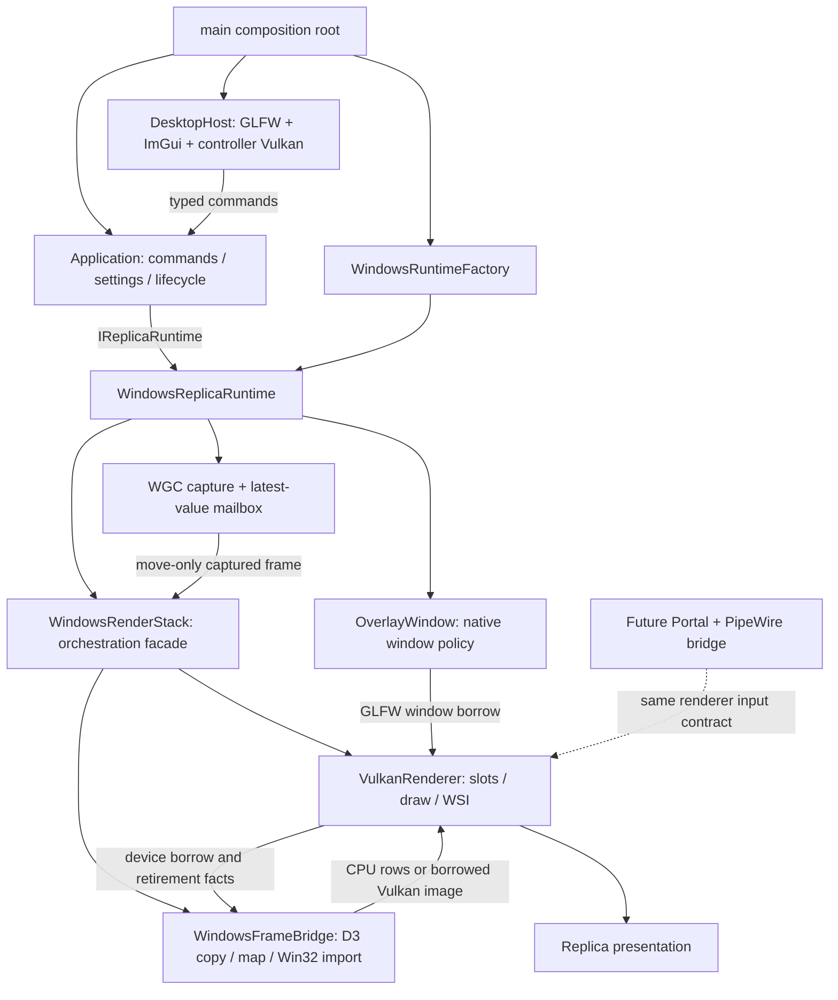
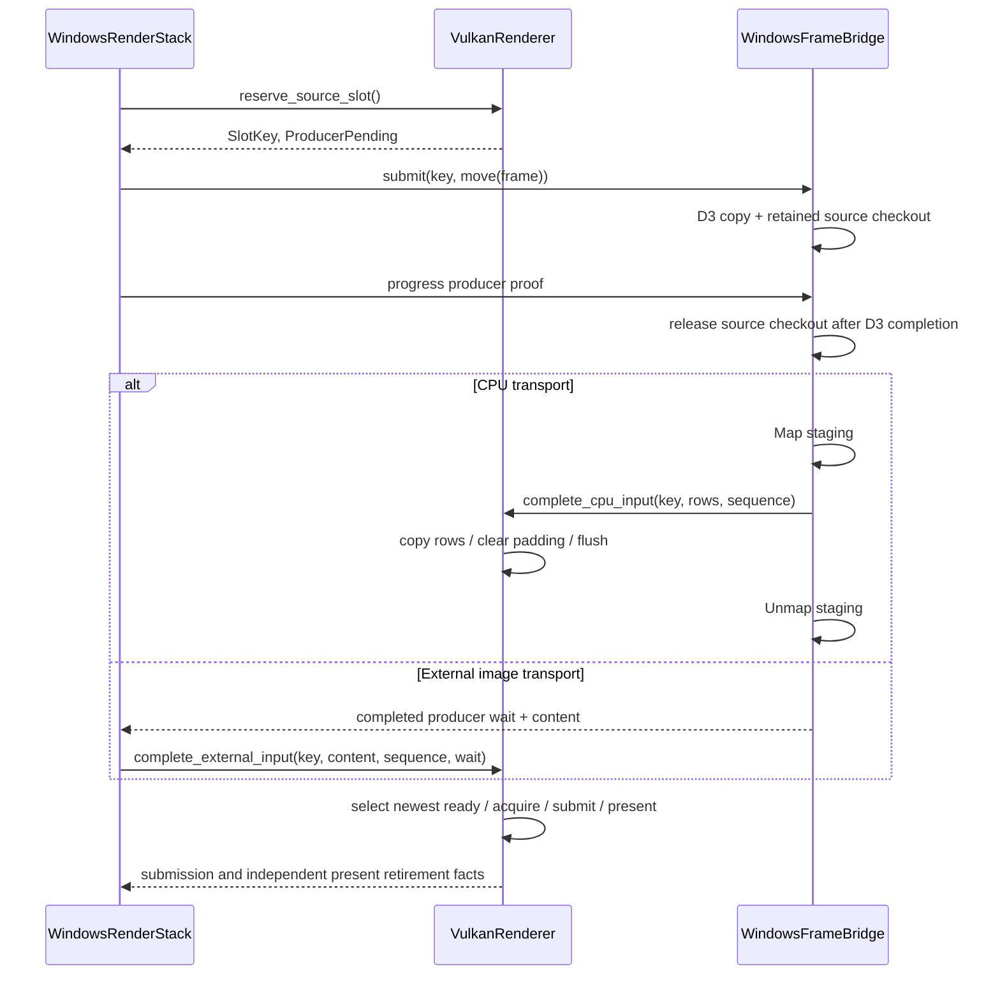

# Vulkan 共用渲染邊界與效能改善規格

日期：2026-09-15。狀態：spec rolling review 第三輪通過，0 Critical／0 Medium。對象：avb0795，目前工作目錄為 `D:/document/MesRepo/Airelinna`。

## 1. 目的、範圍與決策

為了讓 Windows 與未來 Linux 使用相同的繪製流程，同時降低常駐擷取的 CPU 與資源管理成本，系統需要清楚區分「取得來源影像」、「把影像交給 Vulkan」、「以 Vulkan 顯示影像」三項責任。本規格採用一個共用 replica Vulkan renderer，搭配平台擷取／匯入元件。Windows 既有 D3D11 用於 WGC 與資源互通，繪製管線持續使用 Vulkan。

本輪交付包含：

1. 共用 Vulkan renderer 與 Windows frame bridge 的實際拆分，以及編譯相依邊界。
2. Controller UI 更新節奏與 application／graphics 進度的分離。
3. Controller、replica 的有界同步資源重用。
4. CPU fallback padding clear 與 row packing 的精簡。
5. 小型 opt-in 效能觀測、前後對照與回歸驗收。

後續設計題目為 Linux Portal／PipeWire 實作、ROI 尺寸 transport、producer 完成前的 Vulkan 提交、HDR／多格式輸入。這些項目各自需要來源選取、幾何或同步契約的延伸；本輪以介面約束和量測資料為它們建立起點。現行 opacity、shader crop、快捷鍵、語言、偏好設定、邊框與穿透模式均延續現有行為。

本輪選擇的理由：

| 方向 | 適用目的與代價 | 決策 |
|---|---|---|
| 共用 Vulkan + 平台 frame bridge | 保持單份 shader／WSI／presentation 演算法；每個平台負責其 buffer、匯入與同步語意 | 採用 |
| Windows 增設完整 D3D11 renderer | 可直接整合 D3D 擷取資源；需要另一份繪製、顏色、crop、WSI 與回歸路徑 | 保留為歷史比較 |
| 維持目前混合 render stack 並集中調整熱點 | 短期改動面小；共用 renderer 的拆分工作留在後續階段 | 將低風險量測與 cadence 提前，接續完成邊界拆分 |

本文是目標規格。現況證據以本次 dirty worktree 為準；HEAD `a955d2e` 搭配來源檔 hash 共同辨識完整基線。Spec、plan、tests 保留於工作樹；本輪交付為文件。

## 2. 現況證據

| 現有位置 | 已核對的行為 | 設計含義 |
|---|---|---|
| `src/desktop/desktop_host.cpp` 的 `run`、`render_controller` | 每輪先 graphics progress，再 application step、完整 ImGui frame；graphics pending 約每 2 ms 喚醒 | 為 UI 增設獨立 deadline |
| 同檔 `create_frame_record`、`attempt_present` | 每次 frame 建 command buffer、acquire/submission fence、兩個 semaphore；每次 present 建 fence | 依 retirement 證據重用有界 records |
| `render/windows_render_stack.cpp` 的 `submit`、`progress_d3_copy` | WGC checkout 由 copy slot 保管；CPU 觀察 D3 完成後釋放 checkout、發布 ready input | source lease 與 Vulkan borrow 分別管理 |
| 同檔 `progress_d3_copy`、`record_commands` | CPU 每幀清整個 upload allocation，再逐列複製 content，Vulkan 上傳 allocation extent | 清除範圍可縮至 padding；本輪保持整個 allocation upload |
| 同檔 `record_commands`、`try_present` | crop 使用 shader UV；interop submit 前已有 D3 fence completion；present fence 另外退休 | 保存裁切座標與跨 API 安全條件 |
| `platform/windows/wgc_capture_job.cpp` | `capture_timestamp` 為 intake 時的 `steady_clock::now()` | 報告採 intake-to-submit 命名 |
| `include/avb/app/ports.hpp` | enumerate 與 runtime create 當次回傳清單或 ready/error | Linux 非同步授權需要後續 source acquisition 設計 |
| `cmake/Dependencies.cmake`、`src/CMakeLists.txt` | graphics 建置目前在 `WIN32` 條件內 | 本輪驗收為共用原始碼邊界，Linux 執行驗收另立階段 |

Windows 現行 WGC pool 為 5、replica render slots 為 3、present records 上限為 3。現有 latest-value mailbox 保留一筆 pending frame，以較新來源取代等待中的舊來源；這項低延遲策略延續。

## 3. 系統關係與分層

為了保持應用政策與裝置生命週期各自可驗證，Application 透過既有 ports 驅動 runtime，ControllerView 提交具型別 command。Native window 操作由 DesktopHost 的既有 window port、OverlayWindow 與 Windows adapter 負責。`Vk*` 與平台 handle 的活動範圍位於 native graphics owners。

| 元件 | 決策與所有權 |
|---|---|
| `main` | 組合 application、desktop、factory；選配效能觀測與報告路徑 |
| Application／ReplicaSession | 使用者設定、start/stop、runtime generation 與事件投影 |
| WindowsReplicaRuntime | capture admission、resize／recovery 協調、generation publication、整體 drain |
| WindowsRenderStack | Windows bridge 與 renderer 的組合 transaction；fallback、雙 API loss 的合併結果 |
| WindowsFrameBridge | D3 device/context、WGC lease、copy proof、staging/shared texture、Win32 import owners |
| VulkanRenderer | Vulkan instance/device/queues、CPU upload/image、slots、descriptor/draw、retained redraw、WSI/present proof |
| DesktopHost | Controller 的 input callbacks、UI cadence、獨立 Vulkan device／swapchain／ImGui backend |

Controller 與 replica 保持各自的 Vulkan device 與生命週期。共用部分是值政策與 replica renderer 原始碼；本輪採明確的 concrete composition，新增類別集中於 frame bridge、renderer 與小型 UI cadence policy。

## 4. Renderer 輸入、所有權與建構契約

### 4.1 邊界資料

為了讓平台 buffer 的壽命與 Vulkan 引用期間相互配合，輸入契約需要識別 slot installation、來源順序、有效內容尺寸與可驗證的 producer completion。`render/vulkan_input.hpp` 提供以下內部 graphics 值型別：

- `SlotKey { ring_serial, index }`：renderer 配發的私有 installation identity；每次 ring installation 遞增 serial，包含同一 runtime generation 的 CPU fallback rebuild。Overflow 進入明確 terminal error。
- `CpuRowsView`：短命 `span<const std::byte>`、source row pitch、content/allocation extent、固定 BGRA8 format。同步呼叫期間有效。
- `ExternalSampledImageView`：borrowed `VkImage`／`VkImageView`、allocation extent、format、使用 layout、external queue-family ownership 語意。Registration 綁定 `SlotKey`。
- `CompletedProducerWait`：borrowed timeline semaphore 與 target value；bridge 已以 host observation 證明 producer 完成。
- `VulkanDeviceBorrow`：physical device、logical device、memory properties／limits 與實際啟用的 optional capability facts；owner 為 renderer。
- `ReplicaPresentation`、`PresentationSnapshot`：從現有 Windows header 移出的純幾何／設定資料，保留 crop 與 present-retired 幾何 publication 行為。

這些型別以明確的欄位描述借用，生命週期由 concrete owners 協調。Core／app／ui 的 ports 維持 core 與標準函式庫值型別。

### 4.2 Canonical slot handshake

Renderer 保存唯一一份 slot phase。Bridge 保存以 `SlotKey` 索引的 D3 pending-copy records 與平台資源。Facade 將 producer 結果交回 renderer；bridge 的資料代表 native obligations，renderer 的 phase 代表 slot admission 與 draw eligibility。

契約如下：

1. `reserve_source_slot()` 選取可安全覆寫的 slot、暫存該 slot 原本的 retained designation、撤銷 active retained reference，標記 `ProducerPending`。完整 ring 忙碌時回傳 capacity 結果，mailbox 策略繼續生效。Slot 的 rollback marker 與原有 content／stamp／completed wait 支援驗證失敗時恢復相同 redraw 內容；canonical phase 仍由同一個 `RenderSlotPhase` 表達。
2. 在 copy enqueue 前驗證 source metadata、generation、device、format 與尺寸。驗證或 projection 失敗以 `cancel_source_reservation(key)` 回收 reservation，並在健康、開放的 renderer 中恢復仍符合 retained selection 的舊內容。Bridge 成功 adoption 後的 SafeDiscard 走 `discard_completed_source(key)`，消費 rollback marker 與 reservation。Copy issued 後的失敗保留 producer obligation；Signal failure 沿用 D3 query 取得完成證據。
3. CPU input 的 D3 Map／Unmap 位於 bridge。Renderer 在呼叫內完成 row copy／flush；Map bytes 的 borrow 在 return 結束，使用既有 persistent upload storage。
4. GPU input 的 image registration 跨越多個 frame 與 retained redraw。每次 complete 使用已完成的 timeline target。Vulkan 的外部 ownership acquire/release barrier 與 timeline wait 延續既有實作。
5. Stale key 回傳明確錯誤，當前 ring 保持原狀。Producer completion、discard、detach 的每次 transition 皆驗證 key 與 phase。
6. Drain/fallback 期間，已完成 producer 透過 discard transition 釋放 reservation；D3 pending 保持 polling。Renderer 在 submission retirement 後可選擇 retained redraw 或 safe overwrite。
7. Ring detach 先消除 retained designation、descriptor registrations 與 image references，並收齊相關 submission proof；external owner 接著回收 imported resources。Present record 保管自身 WSI sync 與 swapchain references。

2026-09-16 接線釐清：上述 reservation rollback 延續 `e6266a0` 的來源驗證與 retained redraw 行為。CPU completion 驗證 key／phase、CPU resource kind、allocation／content、pitch／span、upload capacity 與 renderer health；content／stamp 由當次 bridge completion 交付，成功 copy／flush 後與 `CpuReady` 一起提交。FrameStamp 的 sequence 由 facade 發行，producer completion 順序依各 slot 的實際完成證據決定。

### 4.3 資源 owner 與 release proof

| 資源 | Owner | 結束使用的證據 |
|---|---|---|
| WGC checkout | WindowsFrameBridge | D3 copy completed 或該 D3 device confirmed removed |
| D3 staging texture／Map | WindowsFrameBridge | Copy proof；同步 CPU row consumer return 後 Unmap |
| CPU upload buffer/memory/map、sampled image/view | VulkanRenderer | 該 slot submission／retained 使用完成，ring detach |
| D3 shared texture、imported VkImage/View/Memory | WindowsFrameBridge | Renderer 撤銷 registration 與 retained borrow、所有引用 submission 退休 |
| D3 shared fence、imported timeline | WindowsFrameBridge | 對應 ring 與 timeline 使用者完成；fallback 延續現有完整 drain 門檻 |
| Acquire／submission sync、command／descriptor | 各 Vulkan owner | 各自的 acquire／submission proof |
| Present wait semaphore／present fence | 各 Vulkan owner 的獨立 present record | maintenance1 present fence retirement 或該 Vulkan device loss 清理規則 |
| Swapchain／surface | 各 Vulkan owner | image-use、present、release-retained 的現有 ownership policy |
| VkDevice／instance | VulkanRenderer | Imported owners 與所有子資源釋放完成 |
| GLFWwindow | Overlay／DesktopHost window owner | surface 已釋放 |

### 4.4 Device bootstrap 與失敗回收

為了選擇與擷取來源適配的 GPU，同時維持 renderer 的平台中立 header，Windows bridge 先建立 D3 device，再提供短命 candidate-preference callable：`bool(VkPhysicalDevice)`。Callable 在 Windows 實作內查詢 Vulkan ID properties 並比對 D3 adapter；renderer 在建構時同步使用它，優先選擇符合偏好的 WSI-capable device。

Windows 另提供 optional extension 名稱群組及 timeline feature request。Renderer 驗證 extension／feature 支援後啟用完整群組，回傳實際 enabled facts；bridge attach device borrow、自行 resolve Win32 import procedures，建立 device-level capability prefix。取得 WGC initial allocation 後，bridge 依真實尺寸建立 ring textures，逐個 real NT handle 執行 compatibility probes。CPU fallback 仍使用相同 WSI safety floor。實際 handle memory bits 與 image requirements 取交集，dedicated allocation 要求延續。

建構次序：D3 bridge device → renderer instance／GLFW surface／physical device／logical device → bridge attach／device capability prefix → inactive WGC job 與 initial allocation → 依 allocation 建 ring、逐 handle compatibility probes、registrations → aggregate publication → StartCapture。Facade 持有兩個 concrete owner，建構中的每一步採局部 RAII rollback。

結束次序：runtime 關閉 admission 並等待 callback／producer／Vulkan obligations → renderer detach external references → bridge 釋放 import view、image、memory、timeline、D3 owners → renderer 釋放 device／instance → overlay 銷毀。部分建構失敗沿相同相依次序回收已建立資源。

## 5. 安全性與 recovery 相容條件

為了讓重構保存目前可恢復的錯誤路徑，以下條件作為每個實作階段的驗收基準：

1. D3 removal 與 Vulkan loss 各提供自己 API 的完成／清理證據。健康 API 的 pending 工作持續等待其本身 proof。
2. Interop ready publication 使用 host-observed D3 completion；Vulkan submit 中的 timeline wait 在提交時已可滿足。提早 GPU submit 列為後續實驗。
3. Runtime generation 由既有 runtime／factory 協調流程推進；surface recovery 保持 capture generation。Ring serial 負責 allocation installation identity。
4. Fallback 在目前 generation 內維持 CPU latch；新 runtime generation 重新 probe。`ForceCpuBaseline` 仍產生真實 capability facts，保留既有 BridgeReason。
5. Replica 每 tick 最多一次 acquire／submit／present；capture slots 與 present records 各保持三個上限。零 framebuffer、closed admission、terminal／stalled drain 仍推進 retirement。
6. Acquire 採 timeout zero。Uncertain submit/present、ReleaseRetained 與 retired swapchain 皆保存對應 ownership records。
7. Retry budget 於 replacement 的成功 present fence retirement 重設；同時發布對應 presentation geometry 與成功計數。
8. Allocation-idle 判定聚焦 capture image 使用；完整 drain 另包含 independent present records。兩者延續目前呼叫點的不同用途。
9. 所有 error paths 保持有界 records。回收證據待定時維持 owner 與定時 progress，沿用現有 stalled／abandon 處理。

## 6. Controller UI cadence

為了減少 graphics polling 附帶的 ImGui 重建，DesktopHost 需要為「event pump／application step」、「native retirement」、「UI build」保存各自的期限。新增一個 main-thread 的 `UiCadence` 值政策，輸入時間、visible extent 與 activity facts，輸出是否建立 UI frame 及下一個 UI deadline。

| 狀態 | 初始政策值 | 目的 |
|---|---|---|
| 初次顯示／restore | 立即一幀 | 建立最新尺寸與可見內容 |
| 最近 500 ms 有真實輸入、按鍵／滑鼠按住、編輯、popup 或 recorder active | 最快每 16.667 ms 一幀 | 支援拖曳、input trickle、游標與錄製 release barrier |
| 可見且閒置 | 每 100 ms 一幀 | 更新資料、hover tooltip 與時間驅動 UI |
| minimized／zero extent | 事件驅動的一次 input 同步幀 | 維持 focus／錄製狀態；週期性 UI deadline 停用 |

上述數字為起始政策值，效能報告需附上這些值。UI deadlines 跳過過期週期，每個 tick 建立至多一幀。Slot 忙碌時仍進行到期 UI build；native recording／submit 依 capacity 決定。

Host loop 順序：非阻塞 GLFW event pump → graphics progress → application step → 到期 UI build／一次 present attempt → 合併 application／graphics／UI 最早 deadline → event wait。UI command emitted 時立即開始下一輪 application step；每輪仍先 pump events。現有 source auto-refresh、runtime cleanup 及 Quit 的 deadline 延續 application 管理。

真實輸入包括 key、char、mouse button、scroll、cursor position／enter、focus、native hotkey recorder 接受的 chord。Graphics wake 與 capture 的 `host.wake()` 屬於 progress 訊號。Framebuffer／DPI／refresh／iconify 事件另外要求 UI 更新。

沿用目前 ImGui backend 初始化後的 forwarding wrapper 安裝模式。每個 input wrapper 轉送 backend callback 一次，backend 保持先前 callback chain。Framebuffer／content-scale／refresh／iconify 保存並還原原 callback。Focus loss 同步取消 recorder，再轉送 backend；callbacks 使用既有 exception firewall。Activity 同時採 native event 與當前 UI editing facts，以涵蓋 ImGui input queue 的分幀消化。

Hidden input 同步幀的目的是收斂至最新 button／focus 狀態。該幀暫存 `io.ConfigInputTrickleEventQueue`、設為 `false`，執行 backend NewFrame → ImGui NewFrame → ImGui EndFrame，再還原原值；ControllerView command generation 與 native recording 使用可見 UI 流程。同一批 down／up／focus-loss events 因此在這次同步完整消化，hidden UI deadline 隨後停用。可見 UI 保留原本 trickling 設定。既有 cadence SECTION 加入 down → up → focus loss → iconify 且後續保持閒置的序列，檢查 release／focus 狀態與 restore 行為。

本輪採每次 UI build 至多一次 native present attempt；draw data 的有效期留在同一輪 UI build。Graphics-only wakes 處理 retirement 與 recovery。

## 7. 同步物件重用與 CPU 搬移

### 7.1 有界重用

為了降低 per-present allocation，兩個 Vulkan owner 各在自己的既有 state machine 內保存可重用資源。

- Controller 使用最多 `backend_frame_capacity_` 個 frame resources，每組含 command buffer、acquire/submission fences 與 acquire semaphore；render-finished semaphore／present fence 由獨立 bounded present pool 保管。ImGui `RenderDrawData` 的 GPU buffer ring 使用沿用既有 capacity 保護。
- Replica 保持三個 capture slots、三個 present records。Present pool 的 free record 提供 render-finished semaphore／present fence，從 submit reservation 持有到 present retirement。
- Present resources 在提交前 reserve。Capacity 滿時保持 UI／application／retirement 進度，待下一次 admission。
- Command buffer 與 fence reset 發生於相應 proof 完成後。Binary semaphore 的正常重用依對應 wait consumption proof。
- Acquire 成功但 submit guaranteed-not-enqueued，以及 submit 成功但 present guaranteed-not-enqueued，分別保留仍待消耗的 acquire／render-finished signal。沿用安全 proof 後的 destroy/recreate 路徑。
- Uncertain／ReleaseRetained／retired-swapchain records 納入 capacity 計算；穩態重用與例外回復使用同一套 ownership 判定。

穩定尺寸、正常 present、warmup 完成後，command-buffer/fence/semaphore create/destroy 計數保持平坦。Resize、backend-capacity change、device rebuild 與上述 exception paths 允許有證據的 allocation。

### 7.2 CPU padding

為了保留完整 allocation 取樣的定義，同時減少重複寫入，row pack 需要區分有效 content 與 padding。沿用 allocation-sized upload 與現有 UV clamp，逐幀執行：

1. 驗證 content ≤ allocation、pitch ≥ content width × 4，以及 span／destination capacity 足夠；所有乘加先做 overflow 檢查。
2. 每個有效 row 複製 `content.width * 4` bytes。
3. 清除該 row 右側 padding，以及 content 下方的 allocation rows。
4. Flush 非 coherent mapping，範圍遵守 atom alignment 與 allocation 邊界。

令 `A = allocation.width * allocation.height * 4`、`C = content.width * content.height * 4`，每幀 CPU clear 從 `A` 降至 `A - C`，row copy 維持 `C`；content 填滿 allocation 時 clear 為 0。尺寸縮小後的新 padding 在該幀重新清除。D3 source RowPitch 與 Vulkan upload pitch 分別計算，逐列 copy 保留一個同步 CPU 搬移。

本輪 crop 維持 source-content 座標、完整 capture copy 與 shader region sampling。ROI 小區域案例將顯示目前 transport bytes 與完整來源尺寸的關係，提供下一輪 ROI-sized transport 的量測依據。

## 8. Linux 延伸與編譯邊界

為了讓未來平台 bridge 能安全歸還 compositor buffers，共用 renderer 需要完整的 layout／queue ownership、producer proof、import image borrow 及 detach 契約。Windows 外部 image 路徑提供這些契約的第一個實作。

Linux 方向使用 Portal 非同步授權與 PipeWire stream；之後的平台元件負責 DMA-BUF planes／strides／offsets／DRM modifier negotiation、實際 Vulkan import compatibility、explicit／implicit synchronization 與 PipeWire buffer requeue。可用 shared-memory 路徑對接 `CpuRowsView`；DMA-BUF 路徑使用協商後的 sampled image registration。Buffer requeue 時點以 producer／consumer 使用完成為準，retained redraw 需要平台私有 copy 或延長對應 buffer lease 的具體選擇。

Portal 的 CreateSession → SelectSources → Start → OpenPipeWireRemote 為後續 source acquisition 的非同步流程；屆時為 Application 增加 Acquiring／Ready／Cancelled／Error 狀態。本輪 Windows 同步 enumerate/create 契約維持原樣。

新增 `avb0795_vulkan_renderer` target，持有 shared render sources、generated replica shaders、core／Vulkan／GLFW 相依。`avb0795_windows_graphics` 持有 Windows facade／bridge／runtime glue，單向 link 共用 renderer。DesktopHost 使用自己的 graphics owner，以及 renderer target 中的共用值政策。

原本 `graphics_retry_policy` 的 D3 loss／D3 completion／Windows aggregate recovery 部分移入 Windows detail policy。共用 slot phase 採 `ProducerPending`，renderer 根據 producer completion facts 與 Vulkan proof 運作。

`VerifySourceBoundaries.cmake` 同步加入 target／source-root／link allowlists，掃描 shared headers／sources 的 Windows/D3/WGC symbols 與反向 include。Core/app/ui 的既有 native boundary 檢查持續啟用。本輪 graphics target 仍使用 Windows 建置條件；跨平台契約達成以 source／target 邊界與 portable tests 表達，Linux runtime build／capture 驗收留待相應 backend 階段。

## 9. 觀測與前後對照

### 9.1 小型 opt-in report

為了判斷每個變更的實際效果，原生 owners 需要可比較的計數與時間戳。以 `--performance-report <path>` 啟用短期診斷；`main` 建立單一 process-lifetime collector，將借用傳給 desktop 與 runtime factory。Collector 位於獨立 diagnostics target，使用標準函式庫與 JSON serialization，輸入為 scalar observations；app/ui/core 繼續使用既有 ports。

所有觀測於 main thread 彙整。WGC 的 intake timestamp 隨 frame 傳遞，callback 保持原先工作量。Renderer admission、present retirement 與 UI build 分別計數。Collector 保存 counter、三組 duration samples（UI build、intake-to-submit、present-retirement interval）；每組預配置 65,536 筆。Overflow 標記報告為 incomplete。一般啟動保持 collector disabled，hot path 使用一次 optional collector 檢查。

報告於正常 drain 完成、application run return 後輸出一次 JSON。指定路徑採 create-new 語意，檔案已存在時回報明確錯誤並要求另一個路徑。寫入失敗保留正常 owner 清理，命令列回傳報告失敗狀態。報告包含 schema version、由檔名取得的 run ID、bridge mode／reason、adapter／driver、尺寸／FPS cap／present mode、OS、政策值、觀測窗口、samples overflow 及 drain 結果。Build／source fingerprint 記錄於相同 run ID 的外部驗證 manifest。來源標題、HWND、畫面 pixels、偏好設定內容維持在各自功能範圍。

診斷另外接受 `--performance-scope controller|replica`（預設 replica）與 `--performance-bridge auto|cpu`（預設 auto）。Scope 決定 warmup 起算事件；bridge 選項由 composition root 注入 Windows factory 的既有 preference，於本次 process 生效。一般啟動與偏好設定檔保持既有 defaults。Scope 為 replica 時，以第一個成功呈現的 session/generation 鎖定本次樣本；量測期間 session、generation、bridge、allocation 或 FPS/present mode 變動將 run 標記 incomplete，並附原因。

| 指標 | 定義與用途 |
|---|---|
| UI build count／duration | 從 backend NewFrame 前至 ImGui Render 後的 host duration；呈現 UI 工作量 |
| Graphics-only wake count | 有 graphics progress、該輪 UI build 為零；呈現 cadence 分離 |
| Renderer-admitted／submitted／present-retired count | Admission copy、queue submit success、成功 present fence retirement 的各自事件；retained redraw 另計 |
| Intake-to-submit p50／p95 | 被提交新 frame 的 `submit_time - capture_timestamp`；來源為 intake observation |
| Present-retirement interval p50／p95 | 同一 runtime generation 中成功 present fence 退休的觀察間距；附 retired frames 數 |
| D3 copy／CPU copy／clear／Vulkan upload bytes | 演算法 requested bytes；反映資料搬移範圍 |
| Native allocation／destruction counters、pool high-water marks | 每個 owner 分開記錄 command buffer／fence／semaphore 與 slots／presents |

Copy byte counts 代表 API requested 範圍；它們與硬體實際記憶體流量分別解讀。Present retirement 為 host 可觀察的完成邊界，光子延遲由後續專門工具量測。Static source 的 samples 可為空，報告以 `null` percentile 與零樣本數表達。

### 9.2 固定比較集合

每個 baseline／candidate 在相同 Release flags、來源、GPU／driver、SDR 設定、視窗尺寸、FPS cap 與 present mode 下，warmup 10 秒、measurement 60 秒，各跑三次；採 baseline/candidate 交錯順序。Scope 為 replica 時以第一個成功 present retirement 開始 warmup；controller scope 使用第一個 UI frame。每次 run 的 warmup 起點、measurement start/end、停止原因在 JSON 中明列。量測期結束後繼續正常執行，使用者關閉應用觸發 drain 與報告輸出。提早結束標記 incomplete；abandon 採現有 non-unwinding exit，該 run 以 exit status 與缺少完整 JSON 識別。

| 情境 | Source／transport／controller |
|---|---|
| B1 | Controller 可見閒置、尚待選來源；量 UI cadence |
| B2 | Static source、Auto bridge、controller 可見閒置 |
| B3 | 固定 1080p60 動態來源、Auto bridge、controller 最小化 |
| B4 | 同 B3、ForceCpuBaseline |
| B5 | 固定 4K60 動態來源、ForceCpuBaseline、controller 最小化 |
| B6 | 同 B5、source-content crop 固定為左上 25% × 25%；呈現完整 transport 的當前成本 |

每次 run 保存來源測試程式／影片 checksum、作用中 replica 數量、電源設定、validation 狀態、binary SHA256 與 dirty-source fingerprint。使用既有 deterministic hardware source 或固定本機媒體；capture source 格式／尺寸由實際 frame metadata 核對。Process CPU 可使用同一 Windows 觀測工具輔助記錄，raw counters 與 latency samples 為主要可重現證據。

驗收分成結構與效能兩類：

1. B1 閒置 UI 約 10 Hz；input active 上限約 60 Hz；graphics-only 2 ms progress 維持原截止時間。
2. 穩態同步物件 allocation curve 平坦；CPU clear bytes 符合 `A - C`；CPU copy/upload bytes 與輸出畫面相符。
3. B3–B6 以同等 source workload 比較。Present throughput 降低超過 5% 時觸發警戒；intake-to-submit p95 同時增加超過 5% 與 0.5 ms 時觸發另一個獨立警戒。每次 run 的 admitted／submitted／present-retired／dropped counts、retained redraw 與 bridge 選擇一起檢視。超過警戒值需定位原因，決定縮小或退回對應最佳化。
4. 報告結論列出實測差異與環境，將「UI 次數／clear bytes／allocation 減少」與「整體延遲／CPU 使用改善」各自呈現。

本輪保持人工啟動的固定集合與單次 JSON report。長期 benchmark runner、統計平台與多機效能 gate 留給後續需求。

## 10. 精準回歸與驗收

既有 V1 inventory 維持 15 個 top-level cases：Windows policy 12、hardware 3。新增驗證集中約 14 個 SECTION，依現有 case 語意分組：

| 分組 | 新增重點 | 對應現有 case |
|---|---|---|
| Cadence，4 組 | 2 ms wakes 與 UI deadline；active/idle/restore；input trickle/focus；command immediate step/minimized progress | 01、07 |
| Ownership，5 組 | stale ring key；partial bootstrap rollback；retained external detach；independent producer/Vulkan loss；normal／exceptional sync reuse | 08 |
| CPU rows，3 組 | equal extent；padding/shrink；pitch/span/overflow 與 destination bounds | 06、08 |
| Diagnostics，2 組 | timestamp/counter/empty/overflow 定義；warmup/window/create-new report failure | 與觀測 harness 配對的既有 case 08 |

測試驗證 concrete transition／row packing／cadence policy；必要的值政策從真實呼叫點抽取。保留現有 case 13–15 的 WGC、CPU、interop hardware regression。DesktopHost 的真實 GLFW callbacks、ImGui backend pool 與 controller minimize/restore 另以 executable acceptance 驗證，將該證據與 replica hardware tests 分開記錄。

人工 acceptance 包含：連續拖曳／文字輸入／錄製 chord 與 focus loss、source auto-refresh、controller 最小化時持續 replica 與 Quit/drain、來源 resize／關閉、opacity/crop/retained redraw、normal／ForceCpuBaseline 執行。Validation layers 在 correctness runs 啟用；效能比較固定一致的 validation 設定。

## 11. 文件與 review gate

Spec rolling review 以全新 reviewer 檢查本規格與真實來源；主代理逐項查證 Critical／Medium，修正文句、契約或範圍後交由另一個全新 reviewer 完整重審。Spec 達成 0 Critical／0 Medium 後開始 plan；plan 完成相同 gate。完成／中止的 reviewer 保持 inactive，使用新的 agent identity 進下一輪。

實作 plan 需列出每階段檔案、來源方法遷移、驗證命令、必要 SECTION、效能對照與 production commit 邊界。原有 dirty changes 以逐檔／逐 hunk 基線辨識；每個 production commit 採明確 allowlist。Tests、spec、plan 和 review records 保留工作樹。此次文件工作以 source hash 與 staged diff 檢查交付範圍。

## 12. 一手資料

- [OBS 32.2.2 WGC implementation](https://github.com/obsproject/obs-studio/blob/32.2.2/libobs-winrt/winrt-capture.cpp)：在 OBS graphics device 上 copy WGC textures，可作為 Windows 擷取搬移路徑的對照。
- [Vulkan swapchain maintenance1](https://docs.vulkan.org/refpages/latest/refpages/source/VK_KHR_swapchain_maintenance1.html)：present fences 與 image release，支援本規格的 WSI retirement 契約。
- [PipeWire DMA-BUF](https://docs.pipewire.org/1.4/page_dma_buf.html)：buffer 格式／modifier 與同步協商，是未來平台 bridge 的輸入條件。
- [XDG ScreenCast Portal](https://flatpak.github.io/xdg-desktop-portal/docs/doc-org.freedesktop.portal.ScreenCast.html)：非同步 session／source selection／stream acquisition 的控制流程。

來源程式連結：[DesktopHost](../../../src/desktop/desktop_host.cpp)、[現行 render stack](../../../render/windows_render_stack.cpp)、[WGC job](../../../platform/windows/wgc_capture_job.cpp)、[runtime factory](../../../platform/windows/windows_runtime_factory.cpp)、[app ports](../../../include/avb/app/ports.hpp)、[source boundaries](../../../cmake/VerifySourceBoundaries.cmake)、[test inventory](../../../tools/lib/inventory_profiles.lua)。
