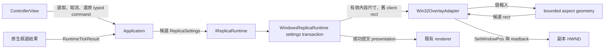

# 框選操作、視窗比例與不透明度拉桿

## 目的與需求

使用者希望以畫面框選決定觀看範圍，並讓副本幾何跟隨選區比例。控制面板提供框選、取消與還原全畫面的入口；不透明度提供與滾輪步幅一致的可見拉桿。

已確認的尺寸規則為：維持目前 client 寬度，依有效內容長寬比調整高度；超出目前螢幕工作區時等比例縮小。Client 中心作為定位基準，外框隨邊界平移回工作區。

## 現況與原因

`WindowsReplicaRuntime::SettingsOperations::apply_geometry()` 以 `border_changed` 作為目前的執行條件；`commit_scheduler()` 更新 renderer presentation 與 adapter aspect。`update_presentation_extent()` 的工作是發布有效內容長寬比，原生 client rect 由既有視窗操作管理。這使選區／全畫面切換後的 renderer 以新比例繪入舊 rect，呈現 aspect-fit 留白。

使用者的截圖與「手動調整一次尺寸就恢復」符合此路徑：手動 sizing／wheel 使用已更新的 source aspect，原生尺寸隨該次事件更新。

## 責任與資料流

Application 持續驗證 session／source／生命週期並提交 portable settings。Runtime 判斷哪些設定轉換需要幾何同步，取得已呈現來源的有效尺寸。Adapter 持有 HWND 查詢、DPI frame insets、work-area 與 SetWindowPos 的責任。純值政策計算矩形，renderer 沿既有 resize／redraw 流程呈現。

## 行為契約

### 控制面板

- 移除 X、Y、Width、Height 的 DragInt，以及「套用範圍」按鈕與相應座標草稿、專用 labels。
- 保留框選、取消框選、還原全畫面、選區操作說明與既有有效來源資訊。
- 還原命令仍攜帶當次 SessionId／SourceId 與 nullopt region；選區資料型別及底層驗證沿用現有契約。
- Opacity 使用 SliderInt，0–100%，格式 `%d%%`，Ctrl-click 數值輸入，AlwaysClamp 與既有 LiveEditOnInputScalar。
- 不透明度維持手勢期間的 runtime preview、完成後的一次保存，以及 hidden-input completion 與 session admission。英文、繁體中文、日文提示跟隨實際操作方式更新。

### 副本幾何

- 觸發條件：接受的 region 或 selecting_region 發生變更，且 runtime 持有可用的已呈現 content extent。包含完成框選、重新進入完整來源框選、取消回到舊選區、還原全畫面。
- 有效內容：選區模式採完整 content；一般觀看採 content 與 region 的有效交集，空交集沿用完整 content。
- 同值設定、opacity／wheel-step／FPS 等其他設定維持當前幾何。既有初始尺寸與逐幀內容尺寸觀察路徑保持原來的職責。
- Fit 維持現有 client 寬度，使用新 aspect 求高度；工作區扣除 DPI-aware frame insets 後，以同一倍率縮小至可容納範圍。
- Fit 的整數結果各軸至少 1 pixel，容許取整數造成的像素級比例差異。自動 fit 採目前寬度與工作區上限；滾輪原有 DPI 最小尺寸規則持續適用於滾輪輸入。
- `SetWindowPos` 使用 `SWP_NOACTIVATE | SWP_NOZORDER`，完成後 readback 驗證目標 client rect。

### 交易與生命週期

- 幾何操作位於現有 fallible settings transaction：保存舊 client geometry → mode／border → fit geometry → extensions／selection activation → native verification → accepted settings／renderer presentation。
- 同次 border 與 region 改變共用同一份原始 client snapshot，fit 使用變更後的 frame insets。
- 幾何或後續操作失敗，沿現有 rollback 恢復 mode、opacity、border、geometry 與 helper state；完整 readback 證據決定一般平台錯誤或 RuntimeStateLost。
- Renderer presentation 與 accepted region 在整筆原生交易成功後發布。Native resize 之後由既有主迴圈推進 framebuffer 與 retained redraw。
- 缺少有效 presented content 的恢復／中斷期間，保留現行 region-clear admission 與既有幾何。初始副本偶發過小另列既有 issue，待使用者重現。

## 精簡實作與驗證

沿用既有交易與幾何模組：抽出 wheel 已有的 bounded-aspect 計算供 wheel 與 automatic fit 共用；新的 fit 入口表達當前寬度政策。加入一個 adapter 的同步 fit 操作並回傳已驗證 client geometry，供交易驗證與 rollback 使用。

測試沿現有 15-case inventory：改寫原本 numeric-region UI SECTION；調整 opacity widget 驗證；新增約三組精確 SECTION，涵蓋 pure fit、hidden native fit、真實 runtime crop/reset retained redraw。Border／mode／work-area／rounding 以小型資料列覆蓋。舊交易 failure tests 持續驗證 rollback ordering，額外 review 核對 concrete runtime wiring。

桌面驗證採 headless ImGui、hidden native HWND 與程式自有、以 no-activate 方式建立的來源／副本。指定測試路徑保持真實滑鼠、鍵盤與焦點由使用者控制；包含 gesture capture／focus 的舊硬體區段保留於使用者操作驗收。

Spec 與 plan 各經全新 reviewer rolling 至 0 Critical／0 Medium；實作分 UI 與 native fit 兩個階段，各自 review、build 與小 commit。Tests／spec／plan／verification／artifacts 保留工作樹，既有 dirty edits 各自保存。
