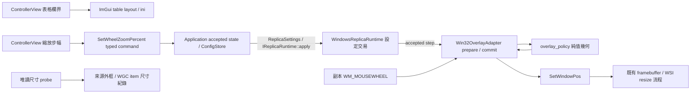

# 來源欄寬與副本尺寸互動

## 目的、需求與範圍

為了讓使用者方便辨識來源並調整副本，介面需要可拖曳的三個表格欄位、初始尺寸的現場確認，以及 Editable 階段的滾輪縮放。這三項沿用現有 UI、來源 owner 與 Windows 視窗 adapter。使用者已授權自主實作與測試；每個階段完成 fresh rolling review，root 查證 findings，達成 0 Critical／0 Medium 後分段 commit。Tests、spec、plan、verification 與 artifacts 保持工作樹資料。

來源位置、視窗選取、crop 與副本幾何沿用當次 session。欄寬由既有 ImGui table settings 管理；偏好 config 保存使用者接受的縮放步幅。

## 現有證據與設計取捨

1. `ControllerView` 的 `sources_table` 使用 Fixed／Stretch／Fixed 三欄，目前 table flags 缺少 Resizable。啟用 ImGui 現成互動可維持原列選取與顏色。
2. Catalog 的 descriptor extent 來自列舉時的 `GetWindowRect`；factory 直接各軸裁限至 960／540。WGC job 從同一來源 item 讀取實際 capture size。來源清單快照與啟動時的內容尺寸具有各自的時間點。
3. 2026-09-19 使用者開啟的 WireGuard：HWND 65650、IsIconic=0、DPI=96、外框 675×525、client 659×486、WGC item 661×518。本次唯讀觀測尺寸正常；使用者遇到的特定操作順序仍屬現場重現項目。
4. 使用者接著回報小副本現象已消失。Root 已說明初始尺寸 production code 保持原樣；本輪先交付可重現的欄寬與滾輪需求，初始尺寸保留診斷紀錄。未來取得重現證據時，可比較固定 960×540、最新 capture extent 的等比例上限，以及內容驅動視窗大小三種選擇。
5. 滾輪可依游標位置或視窗中心縮放；本次採 client 中心，搭配 work-area placement，讓輸入行為與來源像素映射保持清楚。

## 來源表格

為了讓長名稱和 HWND 同時可讀，三欄需要共享既有可用寬度並提供可拖曳欄界。`ImGuiTableFlags_Resizable` 啟用 table 自有互動；Fixed／Stretch／Fixed 與表頭、literal labels、全列 Selectable 保持原語意。兩個內部分隔線皆可拖曳，後續 frame 保存調整結果。調整欄界產生 layout 變化，來源選取由原本列點擊命令處理。

## 啟動尺寸診斷與後續入口

為了找到初始尺寸異常的確切觸發點，診斷需要同時保存來源 HWND、最小化狀態、DPI、outer／client／normal placement、catalog extent、Start 時 canonical item size，以及 replica client／framebuffer。現場 probe 已記錄 WireGuard 的正常狀態，原本事件的操作順序仍待重現。本輪初始尺寸 production code 保持原樣。

後續重現可先在程式自有視窗依序執行「列舉→來源 resize／minimize／restore→Start」，觀察同一 canonical item 的 Size 與 descriptor。人工注入小型 descriptor 可驗證 factory 的資料選擇，實際原生序列可驗證現場假說；兩者分開記錄。若證據指向 descriptor stale，再由 Windows source owner 提供有效 extent、factory 套用一次性初始幾何，使用者後續尺寸由現有 overlay owner 保留。

## Editable 滾輪縮放

為了支援滑鼠與高解析滾輪，adapter 需要保存一個小於 120 的 signed wheel remainder。每個完整 notch 採 `(1 + wheel_zoom_percent / 100)^notches` 尺寸倍率；正方向放大，負方向縮小。多個細分 delta 累積成完整 notch。模式切換、步幅變更與開始框選時清除 remainder，讓下一次互動具有新的起點。

2026-09-19 使用者指定預設步幅 5%，並要求 ImGui 拉桿與數值輸入。控制面板提供 1%～25% 的整數步幅，使用 `SliderInt`，Ctrl-click 進入數值輸入。UI 保存編輯 draft，手勢結束透過 `SetWheelZoomPercent` 一次送出，Application 驗證數值／session／action availability，runtime 接受後提交設定與保存 `.config`。來源選取前後皆可設定，active runtime 立即採用已接受值。

`ReplicaSettings` 與 `UserConfig` 的 `wheel_zoom_percent` 預設為 5。Config 的 optional V1 key 同名；省略或無效值以 5 作局部回復，合法範圍為整數 1～25，其他偏好維持原值。Save 前驗證範圍。純值驗證沿用 core/application 的現有設定路徑，原生 adapter 持有已接受的值；Frontend 透過 typed command 與 view state 串接。

輸入條件為 Editable、一般預覽且游標位於副本 client。PassThrough 與框選期間維持當下幾何。計算使用目前 client、runtime 提供的 source／有效 crop aspect、目前 DPI 的 frame insets 與最近螢幕 work area。

- 以 client 中心為縮放中心，必要時平移 outer rectangle 以符合 work area。
- 以保持比例的方式限制 client 尺寸；一般下限取 160×90 logical pixels 所需的等比例大小，work-area 容量具有最高優先序，極端比例可得到較短的一軸。
- 上限由 work area 減去 frame insets 決定。整數 round-off 允許一個 pixel 的比例誤差。
- 純值政策檢查有效 rect、insets、extent 與 signed coordinate 可表示性；無效輸入保持現有幾何。
- Prepared message 保存計算結果；commit 使用 `SetWindowPos(SWP_NOACTIVATE | SWP_NOZORDER)`。成功後保存 remainder；native failure 保持原本 remainder，沿既有 callback firewall 繼續。
- 有框／無框使用同一政策。Crop 的比例由既有 `update_source_extent` 提供。

## 驗證與交付

為了讓驗證精準對應需求，沿用既有 15-case inventory，擴充約五至七個 SECTION：table 欄界互動、wheel 純值幾何、adapter native input、typed setting／UI gesture、config round-trip／舊檔預設。各組使用少量明確資料列。

驗證包含：

1. 兩個 table 欄界拖曳、下一 frame 保存、commands 保持空集合。
2. 初始尺寸唯讀觀測與實際 reproduction 狀態分別記錄；後續 frame 更新保留使用者調整的尺寸。
3. 正負／多 notch／細分 wheel，minimum／work-area 邊界，負螢幕座標與極端值。
4. Native Editable、PassThrough、框選、有框／無框、crop aspect、DPI，以及可重複的 SetWindowPos failure 行為。
5. WireGuard 的唯讀尺寸紀錄與待重現問題見 `other-issue.md`；使用者提供下一次真實桌面重現。後續驗證採非互動方式，滑鼠鍵盤、焦點切換與真實來源操作留給使用者。
6. 預設 5%、1／25 邊界、非法值與 stale command、active runtime apply failure、restart persistence、UI draft 與單次手勢 commit。

固定效能 candidate 已保存 Task6 snapshot 與 B4–B6 checkpoints。UX candidate 執行 build／非互動 CTest／source boundaries；會佔用桌面的 Task7 native acceptance 與長時間 benchmark 另保留待驗證狀態。文件描述實際完成與驗證範圍，各階段使用明確檔案 allowlist 提交。
